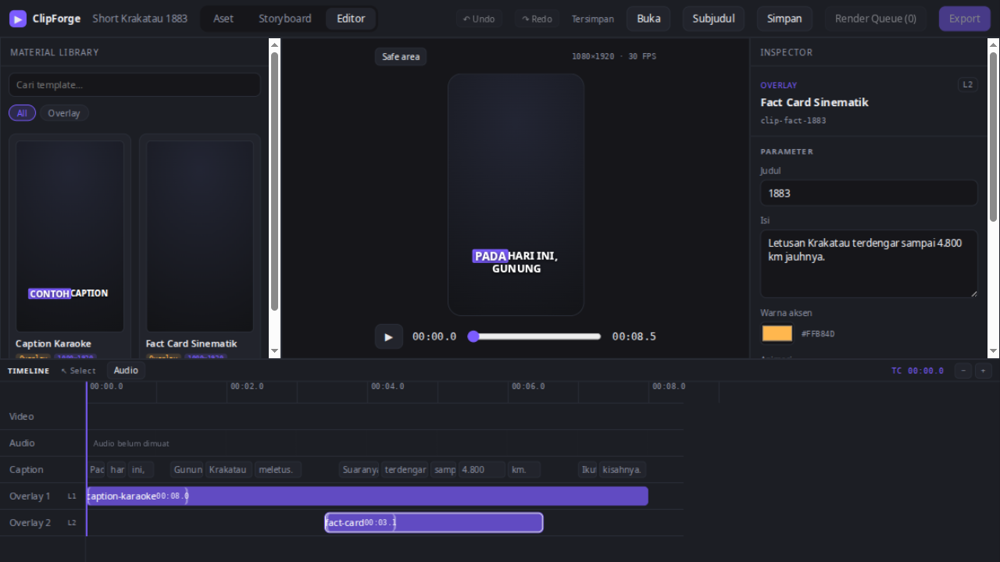

<p align="center">
  
</p>

<h1 align="center">ClipForge</h1>

<p align="center">
  Desktop-first, AI-assisted short-video editor.<br/>
  Audio-aligned subtitle words are the timing anchors; reusable HTML templates are the visuals.
</p>

<p align="center">
  
  
  
  
  
</p>

---

## Why it is built this way

Short-form editing lives and dies by **timing to the voice track**. ClipForge does not store clip
positions as raw seconds: every clip is anchored to **word edges** (`WordAnchor`) resolved from the
aligned subtitle. Re-align or re-record the audio and every caption, fact card and scene follows
automatically. Seconds only exist at preview/render time, resolved through
[`src/lib/anchors.ts`](src/lib/anchors.ts).

Visuals are **standalone HTML templates** (plain HTML/CSS/JS) loaded as iframe layers — scenes as
the base track, transparent overlays stacked on top. A template declares its parameters in a
`manifest.json`; the Inspector renders its edit form from that manifest. See the
[template contract](docs/TEMPLATE_CONTRACT.md).

## Features (verified working in the browser editor)

- **Material Library** — template search, category filters and live 9:16 template previews rendered
  from the actual templates; insert a template at the playhead word.
- **Preview stage** — active scene/overlay template layers synchronized through the template
  `__seek` contract, safe-area guides (90% / 80%), shared transport controls.
- **Inspector** — manifest-driven parameter editing (text, multiline, number, color, enum), resolved
  timing/anchor readout, clip duplicate/delete.
- **Timeline** — word caption track, video/overlay lanes, word-snapped clip **drag & resize**,
  ruler scrubbing, zoom, playhead sync with preview, resizable panel layout (persisted).
- **Undo/redo** — 100-step history with 500 ms coalescing, `Ctrl/Cmd+Z` / `Ctrl+Shift+Z` / `Ctrl+Y`.
- **Project files** — save/open versioned `.clipforge.json` with validation, honest dirty-state
  indicator ("Belum disimpan" until actually saved).
- **Subtitle import** — SRT / WebVTT / JSON parsed into word timings; clip anchors are clamped into
  the new word range automatically.
- **Audio import + waveform** — decode via Web Audio, duration stored in the project, peak
  waveform drawn on the audio lane.

> Render queue, AI assistant, variants and native file dialogs are roadmap items — the UI marks
> them as unavailable rather than faking them. See the [roadmap](docs/ROADMAP.md) and
> [status](docs/STATUS.md) for exactly what is done vs planned.

## Quick start

```bash
npm install
npm run dev          # browser editor at http://localhost:1420
```

Desktop shell (requires Rust toolchain + Tauri platform dependencies, e.g. `libglib2.0-dev` on Debian/Ubuntu):

```bash
npm run tauri:dev
```

## Validation

```bash
npm run templates:index   # regenerate public/templates/index.json
npm run typecheck         # tsc --noEmit (strict)
npm run test              # vitest — 119 unit tests
npm run build             # tsc --noEmit && vite build
```

## Template development

Create `public/templates/<template-id>/` with a `manifest.json` (id, kind, params, defaults) and an
`index.html` that exposes `window.__ready` and a deterministic `window.__seek(t)` per the
[template contract](docs/TEMPLATE_CONTRACT.md), then regenerate the index:

```bash
npm run templates:index
```

## Repository map

| Path | Purpose |
|---|---|
| [`AGENTS.md`](AGENTS.md) | Required workflow & rules for AI coding agents |
| [`docs/SESSION_HANDOFF.md`](docs/SESSION_HANDOFF.md) | Compact cross-session handoff |
| [`docs/STATUS.md`](docs/STATUS.md) | Verified implementation state & validation log |
| [`docs/ARCHITECTURE.md`](docs/ARCHITECTURE.md) | Frontend, state, templates, native layer |
| [`docs/UI_SPEC.md`](docs/UI_SPEC.md) | Target layout & behavior from the design mockup |
| [`docs/TEMPLATE_CONTRACT.md`](docs/TEMPLATE_CONTRACT.md) | Manifest + HTML runtime interface |
| [`docs/ROADMAP.md`](docs/ROADMAP.md) | Milestones M0–M6 |
| [`docs/DECISIONS.md`](docs/DECISIONS.md) | Accepted/proposed architecture decisions |
| [`docs/agent-notes/`](docs/agent-notes) | Per-task reports from AI agents (T1–T5) |

## Status

Early active development (milestone M2/M3). The editor core above works in the browser; the
Tauri-native render pipeline, AI integration and packaging are still ahead. Everything claimed here
is backed by the validation log in [`docs/STATUS.md`](docs/STATUS.md).
